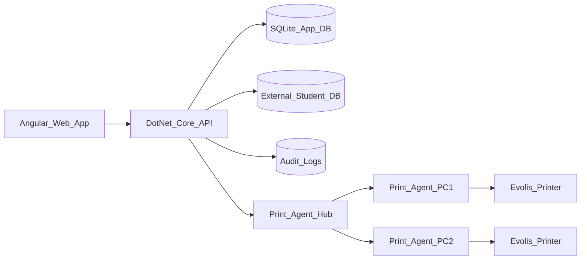

# Centralized ID Card Platform (CardPresso-like)

## Product goal

A web alternative to CardPresso/ID-ALL for **one organization**: design cards visually, bind fields to internal or external databases, manage Evolis printers centrally, print from the browser, and keep a full audit trail — with a thin **Print Agent** on each printer PC (print/hardware only).

## Locked decisions

- Stack: **ASP.NET Core Web API** + **Angular**
- Scope: **single organization** (no multi-tenancy)
- App metadata DB: **SQLite** (on the central server)
- Cardholder data: **per project** — internal SQLite tables, or external DB (SQL Server, MySQL first)
- Design storage: **JSON** templates (front/back)
- Deployment: **central server** + **Windows Print Agent** (thin; no data CRUD UI)
- Auth: local users + **optional Microsoft Entra ID (SSO)** toggled in settings; all keys/secrets **encrypted at rest**
- Designer: **visual drag/drop**
- Audit: dedicated module for actions, errors, and system logs
- Inspiration: CardPresso, centralized and multi-user within one org

## Repository and workspace

- Local path: `C:\ahmed\Projects\Me\Card Managment` (folder exists, currently empty, no `.git` yet)
- Remote: `https://github.com/ismarteg/CardManagment.git` (appears empty / no refs)
- Setup on execution:
  1. Move agent workspace root to that path
  2. `git init`, add `origin` remote
  3. Scaffold solution under that folder
  4. Add `.gitignore` (Visual Studio / .NET / Angular / secrets)
  5. First commit + `git push -u origin main` when you ask to commit/push

## High-level architecture



- **Angular web app** is where users browse/edit students (or other records), design cards, and start print jobs.
- **Print Agent** is a small Windows tray/service: pairs with the server, discovers Evolis printers, receives jobs, prints, reports status. It does **not** host the data management UI.
- API owns projects, designs, connections, print queues, settings, and audit.
- Agents use SignalR (or secure WebSocket) to the central API.

## Core domain: Project-centric

Each **Project** owns:

| Concern | Stored in |
|---|---|
| Name, card size (CR80), sides | SQLite |
| Data mode: `Internal` or `External` | SQLite |
| Connection settings (encrypted) | SQLite |
| Field catalog / mappings | SQLite |
| Card design JSON (front/back) | SQLite (+ assets on disk/blob) |
| Default printer / print options | SQLite |
| Print history for this project | SQLite |

**Data field connections** = map design tokens (`{{FullName}}`, `{{Photo}}`, `{{StudentId}}`) to either internal columns or external table/view columns (and optional SQL filter).

## Solution structure (monorepo)

Root: `C:\ahmed\Projects\Me\Card Managment`

- `src/IdCard.Api` — ASP.NET Core API, auth, projects, connectors, jobs
- `src/IdCard.Domain` — entities, enums
- `src/IdCard.Infrastructure` — EF Core (SQLite), file storage, encryption
- `src/IdCard.Connectors` — pluggable DB providers (SqliteInternal, SqlServer, MySql)
- `src/IdCard.PrintAgent` — Windows service/tray app (Evolis SDK)
- `src/IdCard.Web` — Angular SPA (designer, data browser, print UI)
- `docs/` — architecture, agent install, Evolis notes

## Modules (MVP first)

### 1. Auth (single organization)
- No multi-tenancy / no `OrganizationId` partitioning
- Local users + roles: Admin, Designer, Operator
- JWT for API sessions after login
- **Optional Microsoft Entra ID SSO** (OpenID Connect):
  - Settings UI: enable/disable SSO
  - Store TenantId, ClientId, ClientSecret (encrypted), redirect URIs in SQLite settings
  - When enabled, users can sign in with Microsoft; map/link to local user + role
- Local username/password remains available (SSO is additive, not forced)

### 2. Projects
- CRUD projects
- Wizard: create project → choose data mode → connection → discover tables/fields → create design → assign printer

### 3. Data management (in the web app only)
- **Internal mode**: editable record grid in SQLite (custom fields + photo); import CSV/Excel; add/edit/delete from Angular
- **External mode**: test connection, pick table/view, map fields; photos via path/URL/BLOB; write-back rules defined per project (read-only by default for external DBs unless explicitly enabled)
- Connector interface: `IDataConnector` with `TestAsync`, `ListTablesAsync`, `ListColumnsAsync`, `QueryRecordsAsync`, `GetPhotoAsync`

### 4. Visual card designer (Angular)
- Canvas sized to CR80 (printable DPI, e.g. 300)
- Layers: background image, text, dynamic field, photo frame, barcode/QR, rectangle/line, static image
- Properties panel: font, color, alignment; conditional visibility in phase 2
- Front/back tabs; JSON schema versioned (`designVersion`)
- Live preview against a selected record
- Soft-proof PNG/PDF; production print still via agent

Example design element (conceptual):

```json
{
  "side": "front",
  "elements": [
    { "type": "image", "src": "assets/logo.png", "x": 10, "y": 10, "w": 80, "h": 40 },
    { "type": "photo", "field": "Photo", "x": 200, "y": 30, "w": 120, "h": 150 },
    { "type": "text", "field": "FullName", "x": 20, "y": 200, "fontSize": 14 },
    { "type": "qr", "field": "StudentId", "x": 220, "y": 200, "size": 60 }
  ]
}
```

### 5. Printers and Print Agents (thin desktop component)
**Recommended split (locked in this plan):**

| Piece | Responsibility |
|---|---|
| Angular web app | Login, projects, student/data CRUD, designer, start print, view job status |
| Print Agent | Register PC, list local Evolis printers, heartbeat, pull/receive jobs, call Evolis SDK, report Done/Failed |

- Agent is a Windows tray app + background service — **not** a second CardPresso-like desktop for managing students
- Server: printer registry (name, model, agentId, online/offline, capabilities/status)
- Pairing: admin generates short-lived code; agent claims it and stores agent token (encrypted locally)
- Evolis-first via SDK/driver; abstract `ICardPrinterDriver` for later brands
- Project default printer + per-batch override

### 6. Print action
- In web UI: select records → design → printer → queue
- Server renders card faces + optional encoding payload
- Agent prints card-by-card; status: Queued → Sent → Printing → Done / Failed
- Reprint / cancel; every transition written to audit

### 7. Audit log module
Central append-only audit store in SQLite (or rotating files + DB index for heavy volume):

- **Who**: userId, userName, actor type (`User` | `System` | `PrintAgent`)
- **What**: action code (e.g. `Project.Created`, `Record.Updated`, `Print.Queued`, `Auth.LoginFailed`, `Agent.Offline`)
- **Where**: projectId, entity type/id, agentId, printerId when relevant
- **Details**: JSON payload (before/after diffs for edits, error message/stack for failures — no secrets)
- **When**: UTC timestamp, correlation/request id
- Sources: API middleware (HTTP), domain events, agent heartbeats/job errors, unhandled exceptions
- Admin UI: filter by date, user, action, project, severity; export CSV
- Retention setting (e.g. keep N days) configurable later

## Encoding and advanced CardPresso features (phase 2+)

Hooks now, build later:

- Magnetic / contact / contactless encoding on the job
- Conditional printing / multi-layout by record type
- Webcam/TWAIN capture (browser and/or agent helper)
- Auto-print on DB change
- Overlay/UV panel options for Evolis

## Security essentials

- **All secrets encrypted at rest** via ASP.NET Data Protection (or equivalent): DB connection strings, Microsoft SSO client secret, agent tokens, any future API keys
- Never return decrypted secrets to the UI (mask; allow rotate/replace only)
- Agents authenticate with paired tokens; rotate on re-pair
- Role checks on projects and admin settings
- Parameterized connector queries only (no free-form SQL from UI in MVP)
- Audit every sensitive action and failure

## Suggested delivery phases

**Phase 1 — Foundation**
- Git init + connect `origin` at `C:\ahmed\Projects\Me\Card Managment`
- Scaffold, SQLite schema, local auth + roles, Projects CRUD
- Settings skeleton (SSO toggle fields encrypted even if SSO wired next)
- Internal records + CSV import in web UI
- Basic designer + thin Print Agent + mock driver
- Audit middleware + admin log viewer (basic)
- E2E: record → preview → mock print → audit entry

**Phase 2 — SSO + real data + Evolis**
- Microsoft Entra ID SSO (optional setting)
- SQL Server + MySQL connectors + field mapping
- Evolis driver on agent; printer management; live job queue
- Richer audit filters/export

**Phase 3 — CardPresso parity**
- Designer polish (barcode/QR, dual-side, templates)
- Batch print, reprint, ribbon/status
- Multi-layout / conditional print

**Phase 4 — Differentiation**
- Multi-site agent dashboard, encoding, HR/SIS APIs, photo capture tools

## Key technical choices (defaults)

- EF Core + SQLite for app DB; migrations from day one
- OpenIddict or built-in JWT + Microsoft.Identity.Web for Entra SSO
- SignalR for agent realtime channel
- SkiaSharp or ImageSharp for server-side card rasterization
- Angular standalone + Fabric.js or Konva for designer
- Data Protection keys persisted so encrypted DB values survive restarts

## Risks to watch

- Evolis SDK licensing and Windows-only agent constraints
- Photo quality / DPI for plastic cards
- External DB schema diversity — flexible field mapping
- Designer fidelity vs printer color/overlay panels
- SSO misconfiguration — clear settings validation and test-connection for Entra app registration
